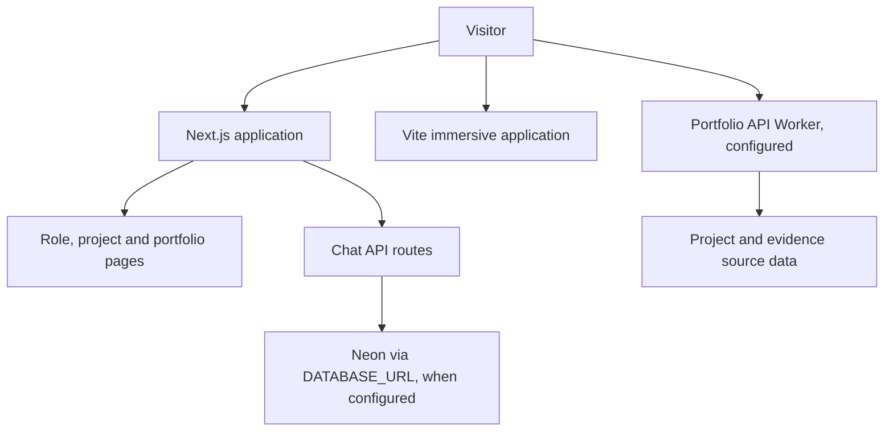

# Engineering Universe — verification snapshot

Date: 2026-11-28 (Asia/Ho_Chi_Minh). Statuses describe observed results, not intended architecture.

## Current source topology

This describes code and configuration, not verified deployed resources or traffic routing. Vite static assets and the Worker have deployment configuration; Next.js remains a standalone Node application for Render. The relationship between deployed components, domain, DNS and HTTPS is unverified.

## Checklist and evidence

| Area | Status | Evidence / remaining work |
| --- | --- | --- |
| Source and Git audit | PASS | Inspected tracked source and Git status. Initial HEAD `7764a858d20ad65a78548548732c474e1337dd5d` was ahead of origin by 3 with four modified files. During work HEAD moved externally to `32be07214bbe80d2eec49f130d8208f57b81cca0`; inspect provenance and diff before pushing. |
| Neon credential revocation | BLOCKED | No verified Neon access or revocation result. `src/lib/db.ts` uses `DATABASE_URL`; environment-variable use does not revoke previously leaked secrets. Rotate the credential at Neon and update all environments. |
| Dependency CVE scan | BLOCKED | Audits for root and immersive both exited 1 with DNS `ENOTFOUND registry.npmjs.org`. No vulnerability report available. |
| Next.js and Cloudflare compatibility | NOT RUN | Standalone output exists, but no verified Next.js adapter build or complete Cloudflare deployment. |
| Docker and Render configuration | NOT RUN | Config updated; Docker daemon access denied at Colima socket. Render fallback and rollback not exercised. |
| Animation lifecycle | NOT RUN | Requires runtime and memory profiling. |
| Next.js build | PASS | `npm run build` exited 0, generated 13 static pages; builds overlapped with frontend edits, so repeat sequentially on the final revision before release. |
| Vite build | PASS | `npm run build --prefix immersive` exited 0. TypeScript and Vite completed. Main bundle: 55.56 kB gzip, Three.js chunk: 45.44 kB gzip. |
| Recruiter / technical lead modes, six role pages, shared content, 3D simulations, IncidentIQ | NOT RUN | Source exists and targeted route fixes were made; end-to-end behavior and source accuracy are not fully verified. |
| CVs, certificates, links | NOT RUN | Full asset, external link and factual audit remains. |
| Wrangler | PARTIAL | API Worker and freshly built Immersive Static Assets both passed Wrangler dry-run. Six asset files detected. HTTP preview and deployment remain unverified. |
| Unit and integration tests | PARTIAL | `npm test --prefix immersive` passed 1/1 after fixing the missing `motion.button` test mock. Integration tests remain unverified. |
| Playwright | BLOCKED | Installed Playwright expects Chromium revision 1255. Cached headless Chromium revision 1148 exited during launch when tried explicitly. Browser E2E and WebGL remain unverified. |
| TypeScript and ESLint | PASS | `npm run type-check` and `npm run lint` exited 0 after frontend changes; no ESLint warnings. |
| Secret scanning | NOT RUN | Limited tracked-file pattern search is not a complete history scan; CI scan was strengthened but not run in GitHub. |
| Lighthouse, viewport, WebGL, fallback, CPU/RAM/FPS, bundle size, leaks | NOT RUN | Requires browser runtime and repeatable measurements. No benchmarks asserted. |
| CI/CD and staging | NOT RUN | CI configuration changed locally; no verified Actions run or staging smoke test. Automatic deployment was removed pending verified gates and staging. |
| Cloudflare Workers, assets, DNS, HTTPS, security, rate limiting, secrets, logs, cost | BLOCKED | Cloudflare authentication could not refresh because its server was unreachable. No deployed resources, quota or costs verified. |
| Production deployment and verification | BLOCKED | Quality gates incomplete, Cloudflare connectivity/auth unavailable and GitHub CLI tokens invalid. No deployment, production URL, CI run, runtime log or rollback test claimed. |
| Architecture, ADR and runbook | NOT RUN | Source topology above is provisional; production infrastructure diagram, ADR and operational runbook need verified deployed resources. |

## Next actions

1. Revoke the exposed Neon credential in Neon, issue a replacement and update environment secrets; do not paste credentials into the repository or logs.
2. Restore npm registry connectivity, run `npm ci` in root and `immersive`, then run audits, builds, type checks, lint and tests sequentially where build artifacts overlap.
3. Authenticate GitHub and Cloudflare with the correct account and least-privilege permissions. Review HEAD and the full working tree before any push.
4. Provision or identify a free-tier preview, verify routing and headers, run staging smoke tests and performance checks, then deploy only after gates pass. Confirm actual quota and pricing before provisioning.
5. Verify production routes, assets, logs and rollback; replace this snapshot with command outputs, CI URL, commit SHA and production URL.
